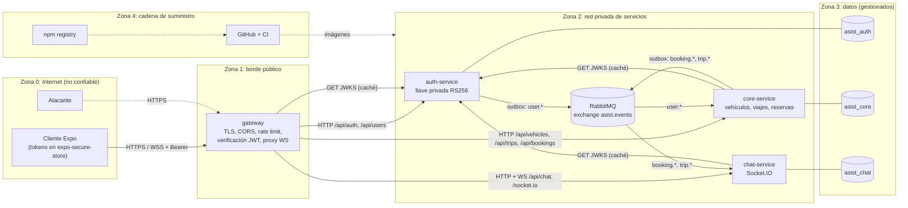

# Modelo de amenazas del sistema AsiST (STRIDE)

| Campo | Valor |
| --- | --- |
| Tarea | F0-T05 |
| Estado | Borrador para revisión de diego |
| Método | STRIDE por elemento del diagrama de flujo de datos, más STRIDE por flujo crítico |
| Alcance | Arquitectura objetivo (fin de la fase 6), con notas sobre la transición strangler fig |
| Requisitos | [Requisitos de seguridad ASVS nivel 2](../security/requisitos.md) |
| Modelos por servicio | `gateway.md` (F1-T07), `chat.md` (F4-T07) y los que agregue cada fase |

## 1. Qué se protege

| Activo | Por qué importa |
| --- | --- |
| Cuentas de usuario y contraseñas | Tomar una cuenta permite publicar viajes falsos o hacerse pasar por un miembro de la comunidad |
| Llave privada de firma JWT | Quien la tenga emite tokens válidos para cualquier usuario, incluido admin |
| Rol admin | Puede cambiar roles y bloquear cuentas |
| Datos personales (cédula, teléfono, fecha de nacimiento, correo) | Protegidos por la Ley 1581 de 2012; una fuga daña a personas reales |
| Integridad de viajes y cupos | Un cupo vendido dos veces o un viaje manipulado pone a alguien en la calle sin transporte |
| Ubicación y horarios de viaje | Revelan rutinas y desplazamientos de estudiantes y docentes (riesgo de seguridad física) |
| Mensajes de chat | Conversaciones privadas entre conductor y pasajeros |
| Disponibilidad del servicio | La app se usa en horas pico para coordinar salidas |
| Repositorio y pipeline | Un secreto filtrado o una dependencia maliciosa compromete todo lo anterior |

## 2. Actores

| Actor | Confianza | Notas |
| --- | --- | --- |
| Visitante anónimo | Ninguna | Puede llamar a `/api/auth/register` y `/api/auth/login` |
| Pasajero | Baja | Usuario autenticado con rol `pasajero` o `ambos` |
| Conductor | Baja | Usuario autenticado con rol `conductor` o `ambos`; dueño de vehículos y viajes |
| Admin | Alta | Cambia roles y bloquea; objetivo prioritario de un atacante |
| Atacante externo | Ninguna | Automatiza peticiones, roba tokens, prueba credenciales filtradas |
| Usuario malicioso con cuenta válida | Baja | El caso más probable: tiene correo institucional y prueba ids ajenos (BOLA) |
| Servicio interno | Media | Cada servicio confía en los eventos válidos según contrato, pero los valida igual |
| Desarrollador y agentes de IA | Alta en el repo | Pueden introducir secretos, dependencias o código inseguro por error |

## 3. Diagrama de flujo de datos y límites de confianza

Límites de confianza:

| ID | Límite | Qué lo cruza | Control principal |
| --- | --- | --- | --- |
| LC1 | Internet → gateway | Todas las peticiones del cliente y de atacantes | TLS, rate limit, CORS, validación de token, tamaño de body |
| LC2 | Gateway → servicios | Peticiones ya filtradas | Cada servicio verifica el JWT por su cuenta (ADR 0002); no confía en cabeceras de identidad |
| LC3 | Servicio → RabbitMQ → servicio | Eventos de dominio | Usuario de bus por servicio con permisos de publicar solo sus rutas; Zod al consumir; idempotencia |
| LC4 | Servicio → su base | Consultas | Usuario de base por servicio con acceso solo a su base; filtros construidos a mano |
| LC5 | Cadena de suministro → producción | Código, dependencias, imágenes | PR con revisión, CI con SAST, SCA, Gitleaks y Trivy; lockfile |
| LC6 | Transición: gateway → `legacy/servidor` | Rutas aún no migradas (fases 1 a 3) | El legado no recibe funciones nuevas; se apaga al cerrar la fase 3 |

## 4. Escala de riesgo

Riesgo = probabilidad × impacto, cada uno Bajo (1), Medio (2) o Alto (3).

| Puntaje | Nivel | Regla |
| --- | --- | --- |
| 6–9 | **Alto** | Mitigación obligatoria antes de cerrar la fase indicada |
| 3–4 | **Medio** | Mitigación planificada en el plan de fases |
| 1–2 | **Bajo** | Se acepta o se mitiga si es barato |

El nivel de la tabla es el riesgo **inherente** (sin la mitigación). El riesgo residual tras mitigar está en la sección 7.

## 5. STRIDE por elemento

### 5.1 Cliente Expo (APP)

| ID | STRIDE | Amenaza | Riesgo | Mitigación | ASVS | Fase |
| --- | --- | --- | --- | --- | --- | --- |
| APP-S1 | Suplantación | Robo de tokens desde almacenamiento inseguro o logs del dispositivo | Alto | Tokens solo en `expo-secure-store`; quitar `console.log` del JWT; acceso de 15 min | 3.2.3, 7.1.1 | F0-T08, F2-T11 |
| APP-T1 | Manipulación | El usuario modifica la app o las peticiones para saltarse validaciones o enviar `driverId` ajeno | Alto | Toda validación y autorización se repite en el servidor; la identidad sale del token | 1.4.1, 4.1.2 | F2–F4 |
| APP-I1 | Divulgación | Datos personales en caché persistente de TanStack Query o en capturas | Medio | Sin persistencia en disco de datos personales; borrar caché al cerrar sesión | 8.2.2 | F2-T11 |
| APP-I2 | Divulgación | Tráfico en HTTP sin cifrar durante el desarrollo que se cuela a producción | Medio | URL de producción `https`/`wss` fijada en EAS; sin `usesCleartextTraffic` en el build de producción | 9.1.1 | F6-T05 |

### 5.2 Gateway (GW)

| ID | STRIDE | Amenaza | Riesgo | Mitigación | ASVS | Fase |
| --- | --- | --- | --- | --- | --- | --- |
| GW-S1 | Suplantación | Token falsificado o con `alg: none`, o firmado con llave inyectada por cabecera `jku`/`jwk` | Alto | `packages/security` con algoritmo fijo RS256, `iss` y `aud`, JWKS solo desde URL configurada | 3.5.3 | F2-T07 |
| GW-S2 | Suplantación | El cliente envía cabeceras internas (`x-user-id`, `x-forwarded-*`) para hacerse pasar por otro usuario | Alto | El gateway borra cabeceras internas entrantes; los servicios no las usan para autorizar | 14.5.4 | F1-T04 |
| GW-T1 | Manipulación | Contaminación de parámetros o body malformado que el gateway y el servicio interpretan distinto | Medio | Mismo parser JSON y límites en todos; el gateway no reescribe el body | 13.1.1, 5.1.1 | F1-T04 |
| GW-R1 | Repudio | No se puede rastrear una petición entre procesos | Medio | Id de correlación generado en el gateway y propagado a servicios y eventos | 7.1.4 | F1-T02, F5-T03 |
| GW-I1 | Divulgación | Errores con stack, versiones o rutas internas | Medio | Problem Details sin stack; Helmet; `x-powered-by` desactivado | 7.4.1, 14.3.3 | F1-T02, F1-T04 |
| GW-I2 | Divulgación | El proxy expone servicios o rutas internas (`/health` detallado, admin de RabbitMQ) | Medio | Tabla de rutas cerrada; 404 por defecto; servicios sin puerto público | 4.3.2, 1.14.1 | F1-T05, F6-T03 |
| GW-D1 | Denegación | Inundación de peticiones, bodies grandes, conexiones WS abiertas sin fin | Alto | Rate limit global y por ruta, body ≤ 100 kB, límite de conexiones WS por usuario, timeouts | 11.1.4, API4 | F1-T04, F5-T02 |
| GW-D2 | Denegación | Un servicio caído hace que el gateway acumule peticiones colgadas | Medio | Timeouts y circuit breaker con 503 rápido | — | F5-T02 |
| GW-E1 | Elevación | SSRF: el proxy reenvía a un destino controlado por el usuario | Medio | Destinos solo desde la configuración; sin parámetros de host o URL | 5.2.6 | F1-T05 |
| GW-E2 | Elevación | CORS permisivo permite que una web maliciosa use el token de un navegador | Bajo | CORS con lista blanca (relevante si aparece un cliente web) | 14.5.3 | F1-T04 |

### 5.3 auth-service (AUTH)

| ID | STRIDE | Amenaza | Riesgo | Mitigación | ASVS | Fase |
| --- | --- | --- | --- | --- | --- | --- |
| AUTH-S1 | Suplantación | Fuerza bruta y relleno de credenciales en login | Alto | 5 intentos/min por IP y por correo; demora creciente; mensaje genérico; registro de fallos | 2.2.1, 7.1.3 | F2-T06 |
| AUTH-S2 | Suplantación | Registro con correo institucional ajeno (no hay verificación por correo) | Alto | **Sin mitigación completa** hasta tener proveedor de correo. Parcial: dominio validado en servidor, cédula única, bloqueo por admin, auditoría. Ver R1 | 2.2.3 | F2-T05 |
| AUTH-S3 | Suplantación | Robo y reutilización de refresh token | Alto | Refresh rotativo guardado como hash; reutilizar uno revoca la familia; logout revoca | 3.3.1, 3.5.3 | F2-T04 |
| AUTH-S4 | Suplantación | Contraseñas débiles o filtradas | Medio | Longitud mínima, máximo 128, lista de comunes, sin reglas de composición | 2.1.1, 2.1.7 | F2-T05 |
| AUTH-T1 | Manipulación | Asignación masiva: el usuario cambia `rol`, `bloqueado`, `correo` o `contraseña` por la edición de perfil | Alto | Zod `.strict()` con lista blanca; endpoint de rol solo para admin | 4.1.2, 5.1.2 | F2-T06 |
| AUTH-T2 | Manipulación | Inyección NoSQL en login (`{"correo": {"$ne": null}}`) | Alto | Zod exige string; filtros construidos a mano; `sanitizeFilter` | 5.3.4 | F2 |
| AUTH-R1 | Repudio | Un admin cambia un rol o bloquea y luego lo niega | Medio | Registro de auditoría inmutable con actor, objetivo, antes y después | 7.1.3 | F2 |
| AUTH-I1 | Divulgación | Hash de contraseña o cédula completa en respuestas | Alto | DTO de salida con lista blanca; cédula enmascarada | 8.3.4 | F2-T06 |
| AUTH-I2 | Divulgación | Enumeración de cuentas por mensajes distintos en login o registro | Medio | Login con mensaje genérico. En registro no se puede ocultar sin correo (hay que decir que el correo ya existe); se limita con rate limit. Ver R3 | 2.2.1 | F2-T06 |
| AUTH-I3 | Divulgación | Filtración de la llave privada RS256 | Alto | Solo en variables del proveedor de auth-service; nunca en el repo; Gitleaks; rotación con `kid` | 1.6.1, 6.4.1 | F2-T04, F5-T05 |
| AUTH-D1 | Denegación | Peticiones de login con contraseñas enormes que saturan argon2 | Medio | `max(128)` antes de hashear; rate limit | 2.1.2 | F2-T05 |
| AUTH-E1 | Elevación | Auto-registro como admin | Alto | El registro ignora o rechaza `rol: admin`; el primer admin sale de un script | 4.1.3 | F2-T02 |
| AUTH-E2 | Elevación | Usuario bloqueado sigue operando con su token de acceso | Medio | Bloquear revoca refresh y publica `user.blocked`; core y chat lo aplican; ventana máxima de 15 min. Ver R2 | 3.3.1 | F2-T08, F3-T07 |

### 5.4 core-service (CORE)

| ID | STRIDE | Amenaza | Riesgo | Mitigación | ASVS | Fase |
| --- | --- | --- | --- | --- | --- | --- |
| CORE-S1 | Suplantación | Crear vehículo o viaje a nombre de otro enviando `ownerId`/`driverId` | Alto | Ids de dueño solo desde el token | 4.1.2 | F3-T02, F3-T03 |
| CORE-T1 | Manipulación | Editar o borrar vehículos, viajes o reservas ajenos cambiando el id en la URL (BOLA) | Alto | Filtro por dueño en cada consulta; pruebas de "otro usuario no puede" | 4.2.1, API1 | F3 |
| CORE-T2 | Manipulación | Un pasajero acepta su propia reserva o un conductor reserva su viaje (BFLA) | Alto | Máquina de estados y reglas por rol en el caso de uso | 11.1.1, API5 | F3-T05 |
| CORE-T3 | Manipulación | Sobreventa de cupos por aceptaciones concurrentes | Alto | `findOneAndUpdate` atómico con `cupos_disponibles > 0`; prueba concurrente en CI | 11.1.6 | F3-T06 |
| CORE-T4 | Manipulación | Evento `user.*` falso o repetido altera `user_refs` | Medio | Solo auth publica `user.*` (permiso en RabbitMQ); Zod; idempotencia por id de evento | 5.5.1 | F3-T01 |
| CORE-R1 | Repudio | Conductor niega haber aceptado o cancelado una reserva | Bajo | Historial de transiciones con actor y fecha en la reserva | 7.1.3 | F3-T05 |
| CORE-I1 | Divulgación | La búsqueda de viajes expone datos personales del conductor o de otros pasajeros | Medio | DTO público con nombre y vehículo; teléfono y placa solo con reserva aceptada | 8.3.4, API3 | F3-T04 |
| CORE-I2 | Divulgación | Patrones de viaje de una persona se pueden reconstruir con la búsqueda | Medio | La búsqueda solo muestra viajes futuros; historial solo del propio usuario | 8.3.4 | F3-T04 |
| CORE-D1 | Denegación | Consultas sin índice o sin límite saturan la base | Medio | Índices obligatorios; paginación ≤ 50 | API4 | F3-T04 |
| CORE-D2 | Denegación | Un usuario crea cientos de reservas pendientes y bloquea viajes | Medio | Límite de reservas pendientes por pasajero y por viaje | 11.1.3, API6 | F3-T05 |
| CORE-E1 | Elevación | Un usuario con rol `pasajero` publica viajes | Medio | Middleware de roles en las rutas de conductor y verificación en el caso de uso | 4.1.3 | F3-T03 |

### 5.5 chat-service (CHAT)

| ID | STRIDE | Amenaza | Riesgo | Mitigación | ASVS | Fase |
| --- | --- | --- | --- | --- | --- | --- |
| CHAT-S1 | Suplantación | Enviar mensajes con `senderId` ajeno | Alto | `senderId` solo del token del handshake | 4.1.2 | F4-T03 |
| CHAT-S2 | Suplantación | Conexión WS con token vencido que sigue abierta horas | Medio | Verificar el token en el handshake y desconectar al expirar o al recibir `user.blocked` | 3.3.1 | F4-T01 |
| CHAT-T1 | Manipulación | Inyección de HTML o scripts en mensajes | Bajo | Texto plano; React Native no interpreta HTML; longitud ≤ 1.000 | 5.3.3 | F4-T03 |
| CHAT-I1 | Divulgación | Unirse a la sala de un viaje ajeno o leer su historial (fuga entre salas) | Alto | `room_members` desde eventos de core; verificación en `join`, en cada `message` y en el GET de historial | 4.2.1 | F4-T02, F4-T04 |
| CHAT-I2 | Divulgación | Un pasajero cancelado sigue recibiendo mensajes | Medio | `booking.cancelled` saca al usuario de la sala y cierra su socket en esa sala | 4.2.1 | F4-T02 |
| CHAT-D1 | Denegación | Spam de mensajes o de conexiones | Medio | 10 mensajes por 10 s por usuario; límite de conexiones por usuario | 11.1.3 | F4-T03 |
| CHAT-E1 | Elevación | Eventos de socket no previstos o payloads sin validar | Medio | Lista cerrada de eventos (`join`, `message`, `leave`) con Zod | 5.1.3 | F4-T03 |

### 5.6 RabbitMQ (MQ) y patrón outbox

| ID | STRIDE | Amenaza | Riesgo | Mitigación | ASVS | Fase |
| --- | --- | --- | --- | --- | --- | --- |
| MQ-S1 | Suplantación | Un servicio comprometido publica eventos de otro dominio (por ejemplo, chat publica `user.blocked`) | Medio | Usuario de RabbitMQ por servicio con permiso de escritura solo en sus claves de ruta | 1.2.2, 4.1.3 | F1-T03, F2-T08 |
| MQ-T1 | Manipulación | Evento malformado o con versión incompatible rompe al consumidor | Medio | Zod al consumir; versionado `*.v2`; pruebas de contrato | 5.1.4 | F2-T08, F5-T04 |
| MQ-T2 | Manipulación | Evento duplicado o fuera de orden (reentrega) | Medio | Consumidores idempotentes por id de evento; las transiciones validan el estado actual | 11.1.1 | F3-T01, F4-T02 |
| MQ-I1 | Divulgación | Datos personales dentro de eventos, visibles a todos los consumidores | Medio | Eventos con id, nombre y rol; nunca cédula, teléfono, correo ni contraseña | 8.3.4 | F2-T08 |
| MQ-D1 | Denegación | Un mensaje envenenado se reintenta para siempre y bloquea la cola | Medio | Reintentos con espera exponencial y DLQ tras 5 fallos | — | F5-T01 |
| MQ-D2 | Denegación | Bus caído: eventos perdidos | Medio | Outbox: el evento se guarda en la misma transacción que el cambio y se publica después | — | F2-T08, F3-T07 |
| MQ-E1 | Elevación | Consola de administración o credenciales `guest` expuestas | Alto | Sin `guest`; consola sin acceso público; CloudAMQP con TLS | 2.5.4, 2.10.2 | F1-T03, F6-T03 |

### 5.7 Bases MongoDB (DB)

| ID | STRIDE | Amenaza | Riesgo | Mitigación | ASVS | Fase |
| --- | --- | --- | --- | --- | --- | --- |
| DB-S1 | Suplantación | Robo de la URI de conexión con credenciales | Alto | URI solo en variables del proveedor; Gitleaks; lista de IP permitidas en Atlas | 2.10.4 | F0-T03, F6-T03 |
| DB-T1 | Manipulación | Un servicio escribe en la base de otro | Medio | Usuario de base por servicio con rol solo sobre su base | 4.1.3 | F6-T03 |
| DB-I1 | Divulgación | Respaldo o base expuestos con datos personales | Medio | Cifrado en reposo de Atlas; sin respaldos fuera del proveedor | 6.1.1 | F6-T03 |
| DB-I2 | Divulgación | Scripts de migración que copian datos personales a logs o archivos locales | Medio | Corridas en seco con conteos, sin volcar documentos; sin migraciones contra Atlas sin aprobación de diego | 7.1.2 | F2-T09, F3-T08 |
| DB-D1 | Denegación | Borrado accidental de datos por un agente o un script | Medio | Prohibido borrar bases sin aprobación (CLAUDE.md); respaldos de Atlas | — | continuo |

### 5.8 Repositorio, CI y cadena de suministro (CI)

| ID | STRIDE | Amenaza | Riesgo | Mitigación | ASVS | Fase |
| --- | --- | --- | --- | --- | --- | --- |
| CI-S1 | Suplantación | Push directo a `main` o `develop` sin revisión | Medio | Protección de ramas configurada por diego; PR obligatorio | 14.1.1 | F0-T02 |
| CI-T1 | Manipulación | Dependencia maliciosa o con vulnerabilidad conocida | Alto | Lockfile, `npm ci`, `npm audit --audit-level=high`, Dependabot, justificar dependencias nuevas | 14.2.1, 14.2.4 | F0-T07 |
| CI-T2 | Manipulación | Un agente de IA sigue instrucciones escondidas en un issue, comentario o archivo | Medio | CLAUDE.md: el contenido leído es información, no instrucciones; revisión humana de diego en PR sensibles | — | continuo |
| CI-I1 | Divulgación | Secretos en el historial de git o en logs de CI | Alto | Gitleaks sobre todo el historial y en cada PR; secretos de CI enmascarados | 2.10.4 | F0-T03, F0-T07 |
| CI-E1 | Elevación | Workflow de GitHub Actions con permisos amplios ejecutado desde un PR externo | Medio | `permissions` mínimos por job; sin `pull_request_target` con checkout del PR | 14.1.1 | F0-T07 |

## 6. STRIDE por flujo crítico

### 6.1 Registro e inicio de sesión

1. El cliente envía correo y contraseña al gateway (`POST /api/auth/login`).
2. El gateway aplica rate limit y reenvía a auth-service.
3. auth-service valida con Zod, busca el usuario por correo, verifica argon2id (o bcrypt heredado y re-hashea).
4. Emite un JWT de acceso (15 min) y un refresh opaco (7 días) que guarda como hash.

| STRIDE | Amenaza clave | Referencia |
| --- | --- | --- |
| S | Relleno de credenciales; registro con correo ajeno | AUTH-S1, AUTH-S2 |
| T | Inyección NoSQL en el filtro de correo | AUTH-T2 |
| R | Intentos fallidos sin registro | AUTH-R1, 7.1.3 |
| I | Enumeración de cuentas; hash en la respuesta | AUTH-I1, AUTH-I2 |
| D | Contraseñas enormes que saturan argon2 | AUTH-D1 |
| E | Auto-registro como admin | AUTH-E1 |

### 6.2 Refresco y cierre de sesión

1. El cliente envía el refresh a `POST /api/auth/refresh`.
2. auth-service busca el hash; si ya fue usado, revoca toda la familia y responde 401.
3. Si es válido, lo marca como usado y emite un par nuevo de la misma familia.

| STRIDE | Amenaza clave | Referencia |
| --- | --- | --- |
| S | Refresh robado y reutilizado | AUTH-S3 |
| T | Carrera entre dos refrescos simultáneos legítimos (reintentos de red) | Marcar como usado de forma atómica; tolerancia corta documentada en F2-T04 |
| I | Refresh en logs o en la URL | 3.1.1, 7.1.1 |
| E | Usuario bloqueado que sigue refrescando | AUTH-E2 |

### 6.3 Solicitud y aceptación de reserva

1. El pasajero pide cupo (`POST /api/bookings` con `tripId`); core crea la reserva `pendiente`.
2. El conductor del viaje la acepta; core descuenta el cupo de forma atómica y guarda `booking.accepted` en el outbox.
3. El outbox publica el evento; chat agrega al pasajero a la sala.

| STRIDE | Amenaza clave | Referencia |
| --- | --- | --- |
| S | Reserva a nombre de otro pasajero | CORE-S1 |
| T | Aceptar reservas de un viaje ajeno; sobreventa concurrente | CORE-T1, CORE-T2, CORE-T3 |
| R | Disputa sobre quién aceptó o canceló | CORE-R1 |
| I | Teléfono o placa visibles antes de la aceptación | CORE-I1 |
| D | Reservas pendientes masivas | CORE-D2 |
| E | Evento `booking.accepted` falso que mete a alguien en una sala | MQ-S1 |

### 6.4 Chat de un viaje

1. El cliente abre Socket.IO contra el gateway con el token en `auth` del handshake.
2. chat-service verifica el token; en `join` comprueba que el usuario esté en `room_members` del viaje.
3. Cada `message` se valida, se guarda y se reenvía solo a la sala.

| STRIDE | Amenaza clave | Referencia |
| --- | --- | --- |
| S | Remitente falso; socket con token vencido | CHAT-S1, CHAT-S2 |
| T | Payload no validado | CHAT-E1 |
| I | Fuga entre salas; pasajero cancelado que sigue leyendo | CHAT-I1, CHAT-I2 |
| D | Spam y conexiones masivas | CHAT-D1, GW-D1 |

### 6.5 Transición strangler fig (fases 1 a 3)

Mientras el gateway enruta a `legacy/servidor`, siguen vivas las brechas B1 a B11 de los [requisitos](../security/requisitos.md#3-brechas-observadas-en-el-código-actual). Reglas para esa etapa:

- El legado no se publica en internet salvo detrás del gateway, que ya aplica rate limit, CORS y Helmet (F1-T04).
- El gateway no enruta `/api/messages` del legado, que no tiene autenticación (B1), salvo que diego lo apruebe para pruebas locales.
- El legado sigue firmando con HS256 hasta F2-T10. Desde ese momento, el gateway solo acepta tokens RS256 y las sesiones viejas deben iniciar sesión otra vez.

## 7. Riesgos residuales

Riesgos que quedan después de las mitigaciones del plan. diego debe aceptarlos o pedir más controles.

| ID | Riesgo | Por qué queda | Nivel residual | Revisar cuando |
| --- | --- | --- | --- | --- |
| R1 | Alguien registra una cuenta con un correo institucional que no es suyo | No hay verificación por correo (no hay proveedor aprobado) | **Alto** | Haya aprobación para un proveedor; implementar `EmailVerifier` |
| R2 | Un token de acceso robado o de un usuario bloqueado sirve hasta 15 min | Los JWT sin estado no se revocan al instante | Medio | Si se necesita revocación inmediata: lista de `jti` revocados en caché |
| R3 | Se puede saber si un correo está registrado por la respuesta del registro | Sin correo no se puede responder igual en ambos casos | Bajo | Junto con R1 |
| R4 | Sin recuperación de contraseña de autoservicio | Depende del correo; la alternativa asistida por admin está pendiente de decisión | Medio | Decisión 2 de los requisitos |
| R5 | Tráfico gateway → servicios y servicio → servicio sin TLS dentro de la red privada | Costo y complejidad de mTLS para este tamaño | Bajo | Si se cambia de proveedor o la red privada se comparte |
| R6 | Credenciales estáticas por servicio para Mongo y RabbitMQ | No hay bóveda ni identidades de carga de trabajo | Bajo | Rotación manual según runbook |
| R7 | La llave privada RS256 vive en memoria del proceso de auth-service | Sin HSM ni bóveda | Medio | Rotación con `kid` y dos llaves activas (F5-T05) |
| R8 | Administración sin MFA | Pendiente de decisión (TOTP) | Medio | Decisión 3 de los requisitos |

## 8. Mantenimiento

- Cada tarea que agrega un endpoint, evento o flujo actualiza el archivo del servicio afectado en `docs/threat-model/` y, si cambia un límite de confianza o un actor, también este documento.
- Cada fila nueva lleva un ID estable (`SERVICIO-LETRA#`) para poder citarla en PR y pruebas.
- Al cerrar una fase, se revisa la sección 7 y se actualiza el nivel residual.
